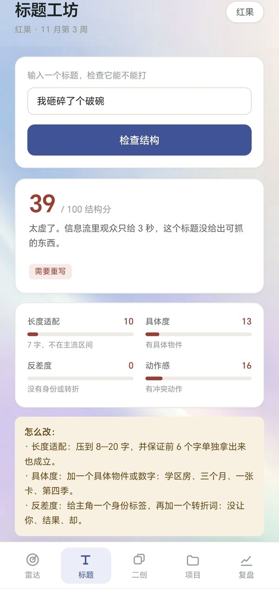

# 漫剧雷达 · 选题与运营工作台

给 AI 漫剧一人剧组 / 小团队用的移动端工作台。从「做什么」到「怎么发」到「发完怎么样」，串成一条线。

**在线使用**：https://zzztt6450-beep.github.io/manju-radar/

形态：单文件 Web App（PWA），可安装到手机桌面，打开无地址栏。数据由 GitHub Actions 定时抓取更新。

<table>
  <tr>
    <td align="center" width="25%"><br><sub><b>雷达</b><br>机会榜 + 本周简报</sub></td>
    <td align="center" width="25%"><br><sub><b>标题工坊</b><br>四维结构诊断</sub></td>
    <td align="center" width="25%"><br><sub><b>二创库</b><br>台词与标签检索</sub></td>
    <td align="center" width="25%"><br><sub><b>项目详情</b><br>多集视频 + 打点</sub></td>
  </tr>
</table>

---

## 五个模块

| 模块 | 回答什么问题 |
|---|---|
| **雷达** | 这个题材现在做还有没有机会 |
| **标题** | 我这个标题能不能打 |
| **二创** | 高光片段在哪、用过没有 |
| **项目** | 我在做什么、做到哪一步 |
| **复盘** | 我做的这些到底成没成 |

这五块不是功能堆叠，是一条闭环：**选题 → 命名 → 二创 → 发布 → 回填 → 反哺下一次选题**。

复盘页会用你自己的项目数据，指出「你总在选哪类题材，而这类题材恰好机会指数最低」。

---

## 各模块的核心逻辑

### 雷达

四个维度加权打分：

- 市场热度 30%（目标平台 0.65 + 另一平台 0.35）
- 供给空间 25%（100 − 在榜数 ÷ 该平台最大在榜数）
- 新 IP 友好度 25%（100 − 续作占比）
- 趋势动能 20%（上升 90 / 持平 58 / 退潮 22）

分档：76 以上值得做，66—75 可以试，52—65 谨慎，52 以下不建议。

另有一个不参与打分的「跨平台时间差」判断。同一题材在红果和抖音经常差 2—4 周，这个差值本身就是机会。

**最能说明问题的一组对比**：同一个「市井生活流」，抖音端在榜 25 部、供给空间接近 0；红果端只有 13 部。题材没变，平台变了，结论就反过来。

展开任一题材还能看到：市场热度 / 供给空间 / 新 IP 友好度 / 趋势动能四个分项、对标爆款（剧名 + 热度 + 题材表现）、跨平台判断、差异化建议、风险、命名结构。

风险与跨平台判断是**实时生成**的：供给压力按当前在榜数分四档、续作压力按续作率分三档、跨端验证按两端差值判断。数据一变，结论跟着变。

### 标题

四个维度，各 25 分：

- **长度适配**：8—20 字是主流区间
- **具体度**：有没有数字、有没有具体物件（学区房、三个月、一张卡）
- **反差度**：有没有身份标签、有没有转折词（却、没让你、才是）
- **动作感**：有没有冲突动词、有没有分句结构

实测分数分布：

| 标题 | 分数 |
|---|---|
| 一套学区房，让邻居盯上了我全家 | 100 |
| 同事请客，刷的却是我的卡 | 88 |
| 顺路载同事三个月，她们真当我是司机 | 87 |
| 重生！丑小鸭逆袭成了万人迷·第三季 | 68 |
| 东北后妈，整顿全家 | 65 |
| 万妖图录传第十四季 | 37 |

最后一条是特例：系列续作靠 IP 认知，可以豁免结构分。界面会提示，新 IP 不适用。

### 二创

分三层：

**第一层：视频本体**
在项目详情页上传本地视频，存在浏览器的 IndexedDB 里（不是 localStorage，几百 MB 的片子放得下）。不上传服务器，纯本地。

**第二层：建立索引**
两条路：

- **播放打点**：播到想要的画面按「记这一刻」，自动抓当前时间码 + canvas 截一帧当缩略图，补一句描述和标签
- **粘贴字幕**：粘贴 SRT 内容，每条字幕自动变成一条可搜的素材，自带时间码

**第三层：搜 + 交付**

- 输入关键词，同时匹配台词文本、标签、类型，点结果跳回视频对应时间点
- **导出清单**：生成 CSV（项目 / 时间码 / 台词 / 标签 / 类型 / 状态），Excel 直接打开，可发给剪辑师或外包。对方拿原片 + 这份表就能自己剪

所以「输入关键词搜出画面」的实现方式是：**台词 + 标签命中，缩略图确认，点击定位**。不是视觉识别。

**剧集链接**：详情页可添加多个链接，命名成「第 1 集」「第 2 集」，点开跳平台。红果和抖音的分享链接在浏览器里通常只能唤起 App，不能直接播，这是平台限制。

「已用 / 没用过」标记，解决的是「不记得哪条已经剪过了」。

### 项目

新建时填剧名、题材、平台、集数、单集成本。填完自动算总成本，并对一下行业基准：**在榜作品 60 集以上占 94%**，低于这个数很难吃到平台的中长剧激励。

发布后回来填热度，复盘页自动判断有没有过百强门槛。

### 复盘

三个输出：

1. **命中率**：已发布 N 个，几个进了百强门槛
2. **题材分布**：产出集中在哪几个方向
3. **偏科诊断**：1/3 以上的项目落在机会指数低于 60 的题材上，会直接指出来

第一次打开项目页是空的，可点「先载入示例数据看看」，一键填 4 个演示项目。

---

## 数据从哪来

抓取层从 5 个公开榜单报道中提取，每 3 天跑一次：

| 来源 | 内容 |
|---|---|
| 澎湃新闻 | 红果 / 抖音 AI 剧漫剧百强榜 |
| 电影界 | 11 月最火 AI 短剧 TOP10（带推荐值） |
| 凤凰网娱乐 | 红果 AI 漫剧 11 月热播榜 TOP10 |
| 飞天影业 | 红果 11 月三大榜单 |
| 电影界 | 红果 11.11 榜单复盘 |

单次合并去重后约 60 部作品，覆盖 10 个题材。

**界面上带 `≈` 的热度是按榜单结构推算的，不是原始披露值。** 这个区分是故意保留的：哪些是硬数据、哪些是推算，一眼能分清。

### 数据管道

```
GitHub Actions（每 3 天 02:00）
        ↓
Python 抓取 5 个来源（trafilatura 提正文）
        ↓
每篇单独调 LLM 结构化（剧名 / 平台 / 热度 / 题材）
        ↓
跨源去重合并
        ↓
按样本占比外推到百强榜口径
        ↓
写 data.json → 提交 → Pages 自动发布
        ↓
App 打开时 fetch ./data.json（no-store，不读缓存）
```

**为什么不在浏览器里做？** 前端 `fetch` 抓不了这些页面，跨域限制会直接拦掉。所以抓取放在服务器上，前端只负责读结果。前端不做它做不到的事。

### 数据不会写坏的五道闸

1. 抓不到正文就跳过该源
2. 单篇解析不出作品就跳过该源
3. 所有源都失败则退出，不写文件
4. 合并样本不足 40 部时，只更新对标样本，不动评分字段
5. 某题材在某平台样本为 0 时，保持原值而不是归零（「没提到」≠「没有」）

最坏的结果是「这次没更新」，不会是「库被写烂」。

### 数据新鲜度

界面顶部按数据日期算天数，分四档：

| 已过去 | 状态 | 表现 |
|---|---|---|
| 30 天内 | 新鲜 | 绿点 |
| 31—60 天 | 偏旧 | 黄点，提示先看最新榜单 |
| 61—120 天 | 已过期 | 红点，只能当历史参照 |
| 120 天以上 | 已失效 | 红点，提示题材周期只有 4—8 周 |

题材判断本身也会过期。所以风险区块会标注「判断写于 X」，超过 60 天变琥珀色提醒复核——**数字能自动，判断不能自动**。

### 手动校准

除了自动管道，数据源页也支持手动改：

- **在榜数量 + 趋势**：直接改数字，即时影响机会分
- **对标爆款**：每个题材可展开编辑，改剧名 / 平台 / 热度，或增删条目
- **导入 JSON**：批量替换，适合换人维护

---

## 安装到手机

**iPhone**：Safari 打开 → 分享 → 添加到主屏幕
**Android**：Chrome 打开 → ⋮ → 安装应用

装完桌面有独立图标（雷达 + 信号波纹），打开全屏无地址栏。没有做离线缓存——数据是核心价值，宁可打不开也不给旧数据。

---

## 技术栈

- **前端**：单文件 HTML + 原生 JS，无框架、无构建、无依赖。所有图标为内联 SVG 与 base64 WebP
- **部署**：GitHub Pages
- **管道**：Python 3 + GitHub Actions + DeepSeek API
- **PWA**：manifest + 三档图标，支持安装

---

## 怎么改

打开 `index.html`，搜索 `const DATA_BASE`：

```js
{
  id: 'shijing',                    // 唯一标识
  name: '市井生活流',                // 展示名
  alias: ['市井','家庭','邻里'],      // 输入框匹配用
  douyin:  { heat: 95, count: 25, trend: 'rising' },
  hongguo: { heat: 48, count: 13, trend: 'rising' },
  sequel: 0.15,                     // 续作占比
  form: 'AI 仿真人剧为主',
  samples: [ ... ],                 // 对标爆款
  risks: [ ... ],                   // 题材固有风险（不含数字）
  edge: '...',                      // 差异化在哪
  naming: { a: [...], b: [...] }    // 命名模板
}
```

- 改评分权重：搜 `WEIGHTS`
- 改标题词表：搜 `hasRole` / `hasAct` / `const CONCRETE`
- 改题材配色与图标：搜 `GENRE_ICON`
- 抓取源：改 GitHub Secret 里的 `SOURCE_URLS`（逗号分隔）

数据存浏览器 localStorage，视频存 IndexedDB，均不上传。

---

## 路线图

- 接视觉模型做画面语义检索
- 标题分接真实 CTR 数据校准
- 多人协作（账号 + 云端存储 + 权限）
- 出海版：TikTok / ReelShort 的题材时间差通常比国内晚 4—8 周

---

## 文件说明

| 文件 | 说明 |
|---|---|
| `index.html` | 主应用（单文件，含全部样式、逻辑、图标） |
| `index-v1-tool.html` | 第一版（单页工具，只有选题雷达），留作对比 |
| `data.json` | 题材数据，由管道自动更新 |
| `manifest.json` | PWA 清单 |
| `icon-*.png` / `apple-touch-icon.png` | 应用图标 |
| `assets/screens/` | README 展示截图 |
| `auto/fetch_data.py` | 抓取 + 结构化脚本 |
| `auto/README.md` | 管道配置说明 |
| `.github/workflows/update.yml` | 定时任务 |

---

数据用于判断方向的决策辅助，不构成立项建议。行业数据来自公开报道，仅供研究参考。
